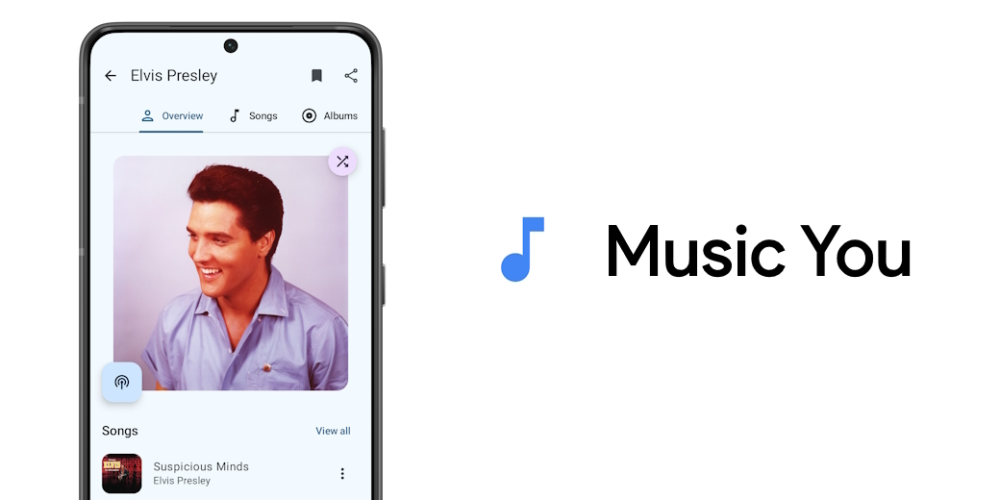
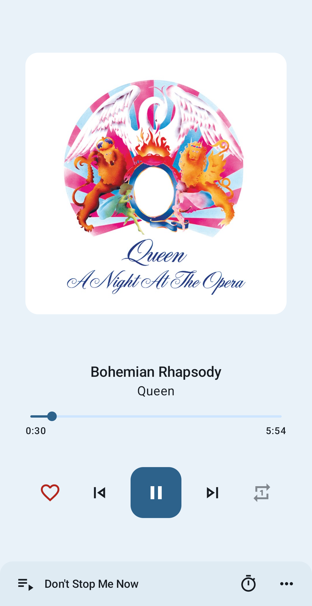
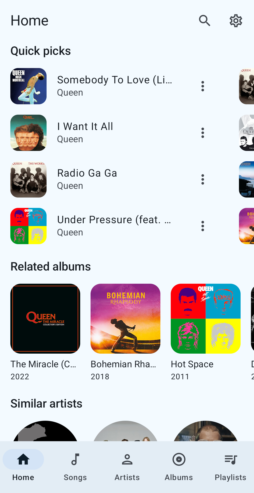
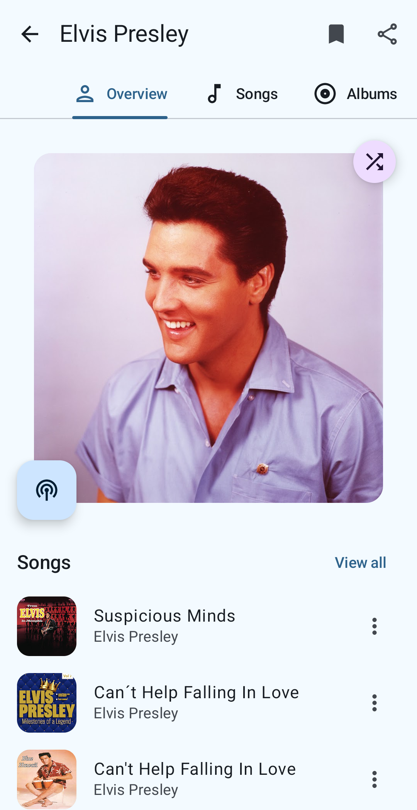
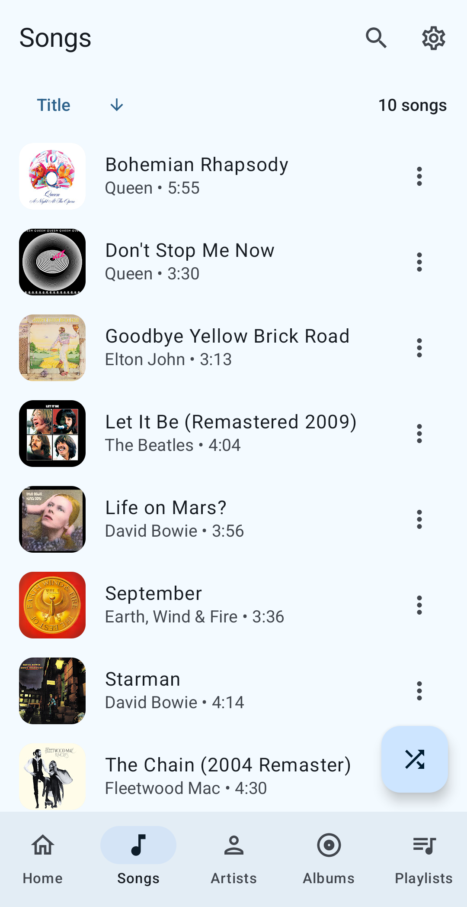
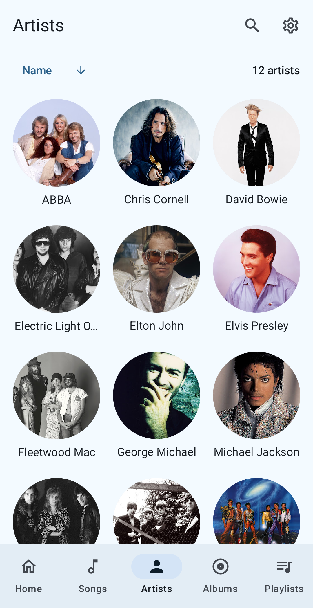
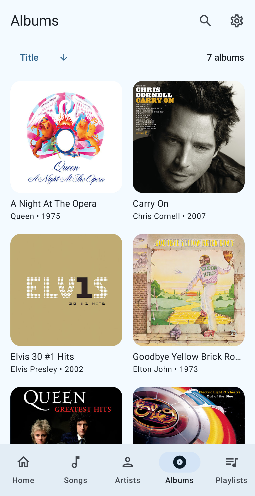

# Myusic

An Android app for streaming music from YouTube Music, with background playback, offline caching and synchronized lyrics.



This project is a fork of [Music You](https://github.com/DanielSevillano/music-you) by Daniel Sevillano, which is no longer maintained. It is rebuilt and maintained here as **Myusic**, with playback, search and lyrics fixes.

## ✨ Features

- Background playback
- Cache songs for offline playback
- Search for songs, albums, artists, videos and playlists
- Bookmark artists and albums
- Import playlists and manage local playlists
- Fetch, display and edit songs lyrics or synchronized lyrics
- Open YouTube and YouTube Music links by default
- Player features, such as sleep timer and persistent queue
- Audio features, such as skip silence and audio normalization
- Other features, such as Android Auto support and invincible service

## 📲 Installation

Build the debug or release APK from source:

```
./gradlew :app:assembleDebug
```

The app id is `io.github.pavitra0.myusic` (debug builds use the `.debug` suffix, so they install side by side).

## 🛠️ Building

- JDK 17
- Android SDK with compile SDK 37

Point Gradle at your SDK in `local.properties`:

```
sdk.dir=/path/to/Android/Sdk
```

## 📸 Screenshots

<div>
    
    
    
    
    
    
</div>

## 📄 License

Licensed under the GNU General Public License v3.0, the same license as the original Music You project. See [LICENSE](./LICENSE).

Because this is a modified version of a GPL-3.0 project, the original copyright notice and license are kept, and the changes are published under the same license.

## ℹ️ Disclaimer

This project and its contents are not affiliated with, funded, authorized, endorsed or in any
way associated with YouTube, Google LLC or any of its affiliates and subsidiaries.

Any trademark, service mark, trade name, or other intellectual property rights used in this project
are owned by the respective owners.
